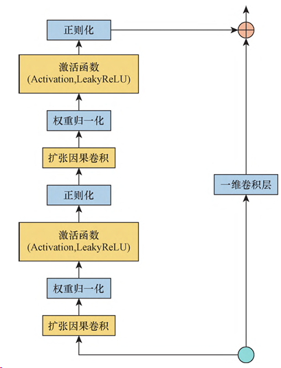
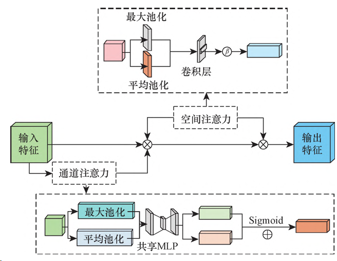
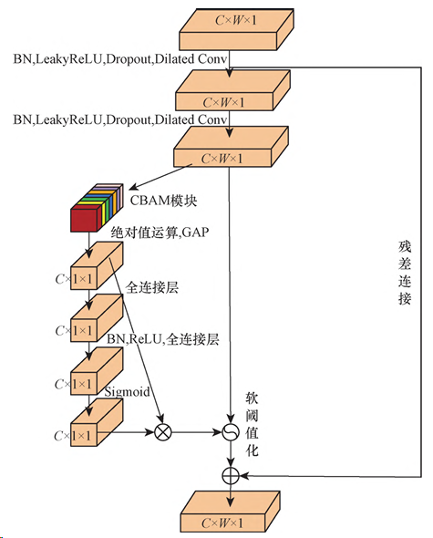
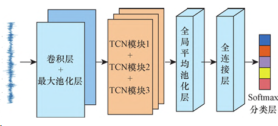
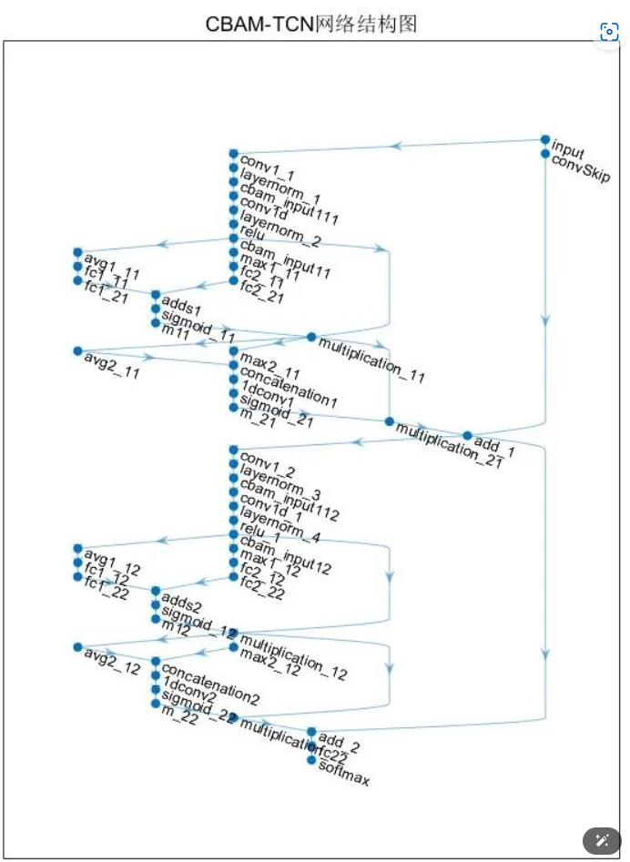
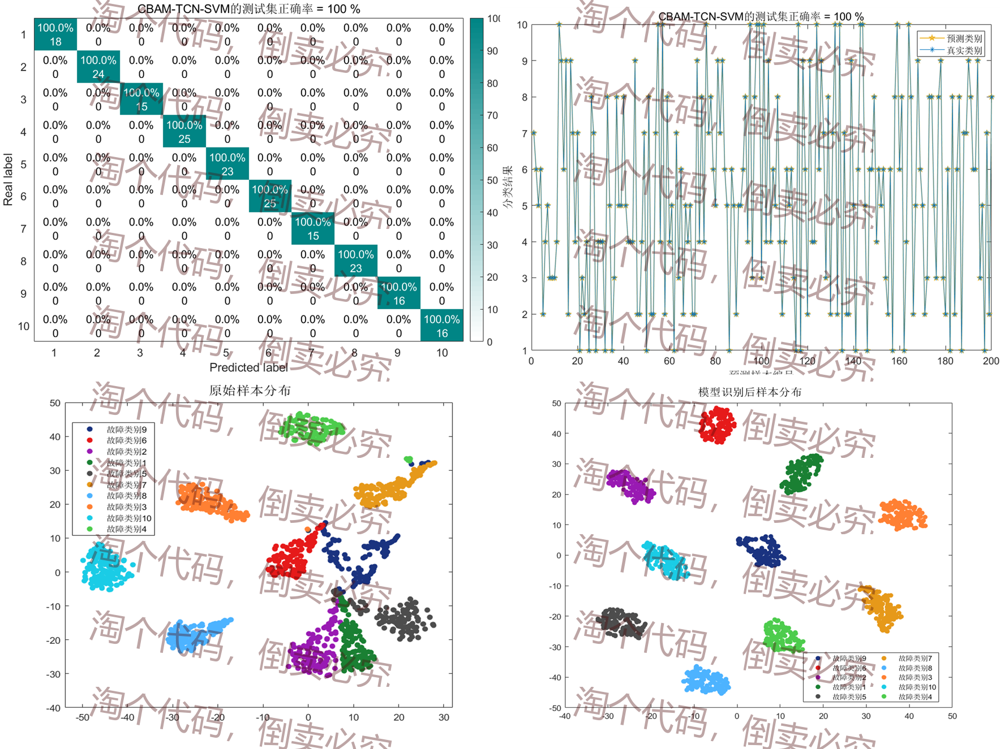
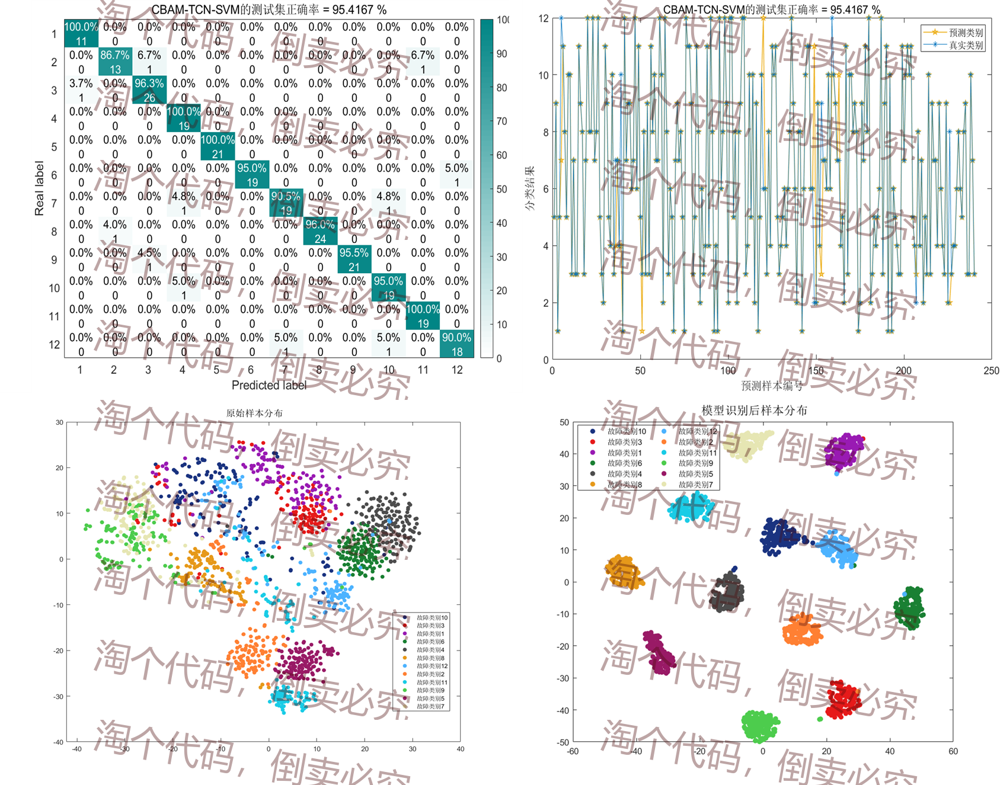
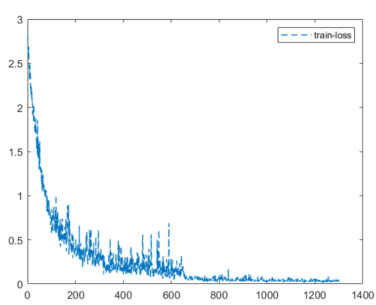
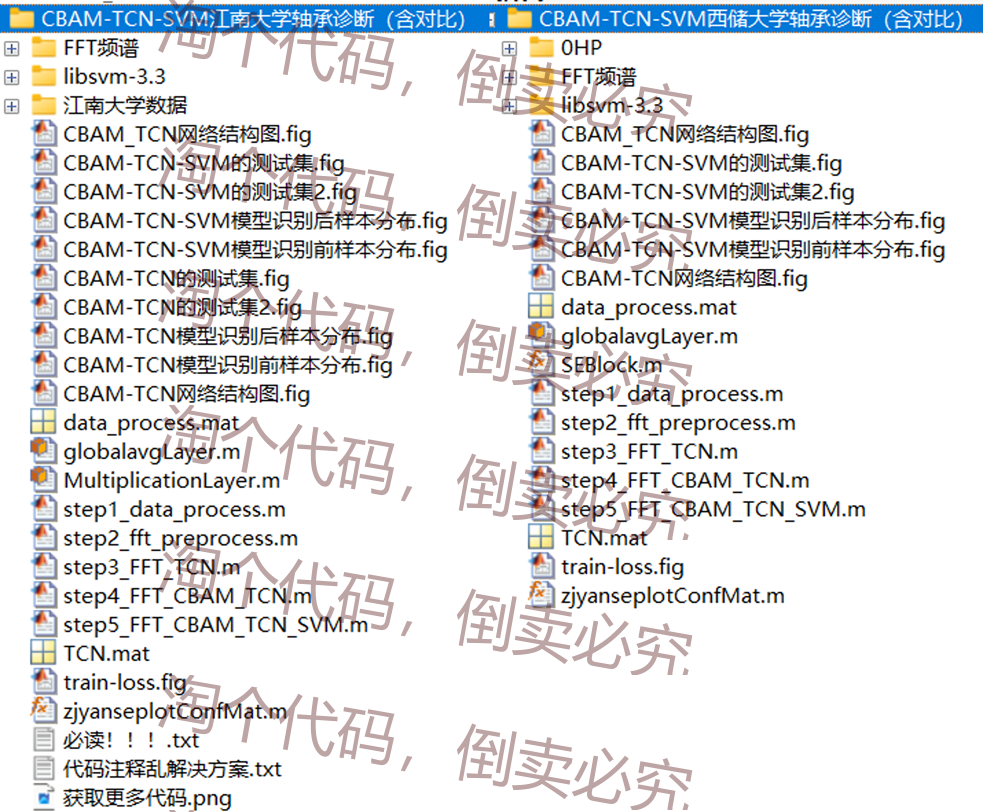

# Small Innovation Model CBAM-TCN-SVM Fault Diagnosis, TCN Network with CBAM Attention Mechanism

Overview
In this period, the CBAM attention mechanism is integrated into the TCN network to enhance its feature extraction capability. This allows the model to selectively focus on channels with critical information when signal morphology changes significantly. By dynamically adjusting the weight coefficients within each channel and spatial location, it can highlight the details of the target, reduce redundant information in feature extraction, and strengthen the model's expressive power.
To further improve the classification capabilities of the network, a classic SVM classifier is replaced with the original Softmax classifier. Tests were conducted on bearing datasets from Xichu University and Jiangnan University, and the results indicate that the proposed CBAM-TCN-SVM model has high classification capabilities.
The CBAM mechanism, by introducing channel and spatial attention mechanisms, effectively focuses on the most important features, helping the network achieve higher accuracy when handling complex tasks. Many scholarly papers have mentioned this direction. For those interested in machine learning and fault classification, this model might be worth exploring as it can help you quickly get started with fault diagnosis.
Introduction to TCN Network
Time Convolutional Neural Network (TCN) is a neural network architecture capable of processing time series data. Compared to traditional convolutional neural networks, TCN can more effectively extract features from time series data. In the TCN network structure, causal convolution is used to extract features from time series data, which enables inter-layer causality and realizes temporal modeling. By expanding causal convolution to expand the receptive field, one convolution can learn more features, adapting to different scales of temporal dependencies. The introduction of residual connections can increase the number of layers in TCN, effectively solving the problems of gradient vanishing and exploding, maintaining stable network performance.
The TCN (Temporal Convolutional Network) network is composed of multiple residual blocks, which are influenced by the expansion factor, filter size, and network depth. As the number of network layers increases, there may be instances of gradient vanishing or exploding. Therefore, it is essential to incorporate a residual module to simplify the training of deep networks, ensuring their stable operation and maintaining good performance. The residual module structure is as follows:
\n        \n  
Introduction to CBAM Attention Mechanism
The Hybrid Attention Mechanism (CBAM) includes both channel and spatial attention mechanisms. The CAM (Channel Attention Module) module performs channel attention, while the SAM (Spatial Attention Module) module performs spatial attention. CBAM combines these two mechanisms in a serial manner, focusing on both the channel and spatial aspects of input features. It uses spatial attention to pinpoint target regions and adjust weights accordingly. Through channel attention, it optimizes the allocation of resources between convolutional channels, enhancing the feature representation capability of the target areas and increasing the TCN's focus on input data, thereby improving model performance. The CBAM network framework is shown below:
\n        \n  
CBAM-TCN network
In the basic TCN module, since valid fault features are ignored by the global average pooling layer, local fault feature information is lost. When the fully connected layer receives the information obtained, it cannot effectively and reasonably combine information related to the fault. Therefore, to enhance the accuracy of fault diagnosis, the TCN needs to strengthen its ability to extract local feature information. By fully representing features, it can more accurately capture the information in the data, thereby improving the model's performance and generalization capabilities.
After the second expansion of the causal convolution layer in the basic TCN module, an CBAM attention mechanism module is embedded. Through the CBAM module, the weights for channel and spatial attention are adaptively learned, enhancing the feature expression ability of the diagnostic model and further obtaining local effective information to capture information related to fault characteristics. It can be considered as capturing the correlation between features across different dimensions, thereby improving model performance. A soft threshold function is introduced into the basic TCN module to retain valid features. The threshold function utilizes a self-network trained through the attention mechanism for adaptive learning, with the threshold not being a fixed value. A sub-network is created within the TCN structure that undergoes training through the attention mechanism. During the training process, the values of the threshold function are dynamically adjusted through optimization to reduce the difference between the model output and the original input. The basic CBAM-TCN module is illustrated as follows:
\n        \n  
CBAM-TCN overall structure:
\n        \n  
Results display
The CBAM-TCN network structure built with MATLAB in this period is as follows:
\n        \n  
Experiments were conducted on bearing data from Xichu University and Jiangnan University.
I. Results of bearing data experiments at Western Reserve University
Data segmentation for 10 fault states under condition 0, collecting 200 samples per state, with each sample size of 1×1024. Training set: validation set: test set = 7:2:1.
FFT-CBAM-TCN-SVM model diagnostic results:
\n        \n  
The diagnostic results on the data of Xichu University can achieve a 100% diagnostic effect.
II. Results of bearing data experiments at Jiangnan University
Jiangnan University data consists of 12 fault states, with each state collecting 200 samples, each sample size is 1×1024. The training set: validation set: test set ratio is 7:2:1. The difficulty of Jiangnan University data is relatively high, and models that can achieve an accuracy rate of over 95% are rare!
\n        \n      \n        \n  
Code directory  
\n        \n  
Follow the steps one by one to execute. The comments are detailed, and all the images above can be run successfully.

## Images

<!-- PAYMENT_BLOCK -->

## Get this dataset

- Payment link (Stripe): [Buy now](https://buy.stripe.com/3cs8yP7sY87d0vu9AB)
- Payment QR code: 

<!-- /PAYMENT_BLOCK -->
